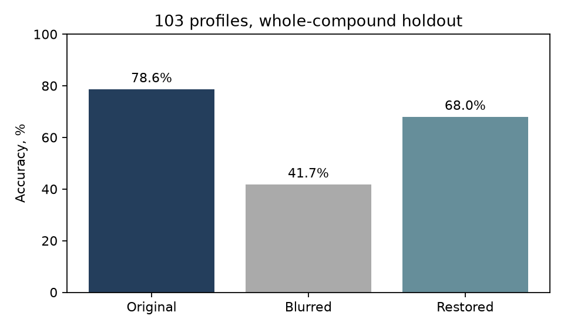
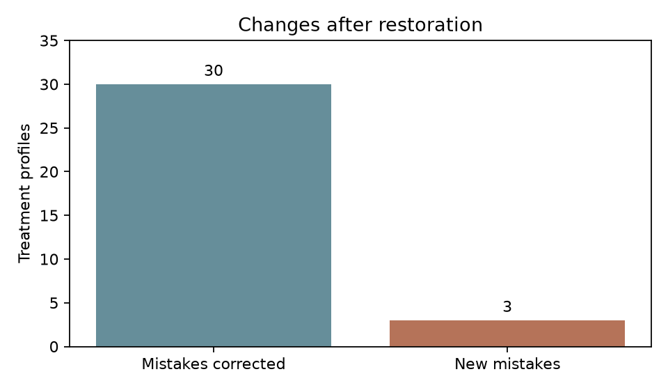

# Compound profiling

[](https://github.com/maribrya/compound-profiling/actions/workflows/check.yml)
Maria Bryantseva · October 2026 · Unpublished research; conference abstract submitted

How does nuclear-channel restoration affect mechanism-of-action classification?
BBBC021 pilot: 297 microscopy fields, 38 compounds, 103 treatment profiles, 12 classes.
83 features; nearest-profile classifier; each tested compound excluded from training.




| Images | Correct / total | Accuracy |
|---|---:|---:|
| Original | 81/103 | 78.6% |
| Blurred | 43/103 | 41.7% |
| Restored | 70/103 | 68.0% |

Restoration corrected 30 mistakes and introduced 3. Gain versus blur: +26.2
percentage points, paired 95% CI 15.3 to 37.9; original accuracy was not recovered.

## Run

```sh
pip install -r requirements-summary.txt
python verify_results.py
```

[Run in Colab](https://colab.research.google.com/github/maribrya/compound-profiling/blob/main/analysis.ipynb) or open [analysis.ipynb](analysis.ipynb) for plots and individual predictions.
For full processing, install `requirements.txt`, then:

```sh
python download_model.py
python inspect_bbbc021.py
python fetch_bbbc021.py
# Rename bbbc021/field_features.json before extracting features again.
python run_bbbc021.py
python evaluate_bbbc021.py
python verify_bbbc021.py
```

Python 3.12; CPU execution. One synthetic blur level; no independent batch holdout;
overlap with restoration pretraining data is not excluded.
Data: [BBBC021](https://bbbc.broadinstitute.org/BBBC021), AstraZeneca;
raw images and original metadata are downloaded separately.
Model: [Cellpose3](https://doi.org/10.1038/s41592-025-02595-5);
CPnet licence in `vendor/cellpose/LICENSE.txt`.
